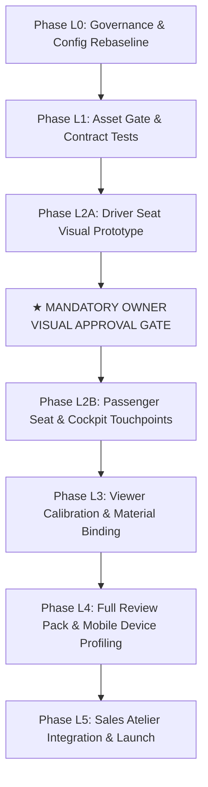

# Lexus RX 350 Demonstration Implementation Plan

**Document:** `docs/LEXUS_IMPLEMENTATION_PLAN.md`  
**Date:** 2026-10-22 (Reconciled & Corrected)  
**Status:** PHASED ROADMAP — READY FOR OWNER AUTHORIZATION  
**Target Vehicle:** 2020 Lexus RX 350 AWD  

---

## 1. Phased Delivery Roadmap

The implementation plan is structured into thin, verifiable phases with an **early visual approval gate** before multi-component modeling begins:

---

## 2. Phase Specifications

### Phase L0: Governance & Config Rebaseline
*Scope: Schema validation, vehicle configuration, and scene manifest updates. Zero 3D modeling.*
1. Create `src/config/vehicles/lexus-rx350-2020.json` conforming to `docs/schemas/vehicle.schema.json`.
2. Create `src/config/scene-manifest.lexus-rx350.json` conforming to `docs/schemas/scene-manifest.schema.json` with zero unresolved slots.
3. Update `src/config/spike-camera-presets.ts` (or create `src/config/lexus-camera-presets.ts`) with the 4 calibrated camera viewports.
4. Update `AtelierHeader.tsx` to display "2020 Lexus RX 350 AWD".
- **Exit Criteria**: `npm run typecheck`, `npm test` exit 0.

---

### Phase L1: Asset Gate & Contract Tests
*Scope: Automated glTF validator update and synthetic fixture. Zero Blender modeling.*
1. Update `scripts/validate-glb.mjs` with `--scope lexus` targeting the 5 Lexus nodes (`GEO_Seat_Front_Driver`, `GEO_Seat_Front_Passenger`, `GEO_Seat_Stitching_Front`, `GEO_SteeringWheel_Lexus`, `GEO_Dashboard_Lexus`).
2. Update `tests/contracts.test.ts` to assert that every Lexus node maps to a defined slot with zero allowlisted missing slots.
3. Generate a deterministic synthetic test fixture (`tests/fixtures/lexus-synthetic.glb`) and prove the gate passes.
4. Run mutation tests (rename node, duplicate material, scale distortion, stripped UVs).
- **Exit Criteria**: All unit, contract, and gate tests pass in Vitest.

---

### Phase L2A: Driver Seat Visual Prototype (First 3D Task)
*Model: Astra High. Headless Blender 5.2.2 LTS.*  
*Scope: ONE driver-seat visual prototype only (`GEO_Seat_Front_Driver` + `GEO_Seat_Stitching_Front`).*

1. Astra authors the driver bucket seat using authentic reference photographs:
   - `AUTOLAB_LEXUS_SEAT_REFERENCE_PACK/01_FRONT_SEAT_COMPLETE/LEXUS_RX_2020_GALLERY_08.jpg`
   - `AUTOLAB_LEXUS_SEAT_REFERENCE_PACK/01_FRONT_SEAT_COMPLETE/LEXUS_RX_2020_GALLERY_23.jpg`
   - `AUTOLAB_LEXUS_SEAT_REFERENCE_PACK/01_FRONT_SEAT_COMPLETE/LEXUS_RX_2020_GALLERY_29.jpg`
   - `AUTOLAB_LEXUS_SEAT_REFERENCE_PACK/03_BOLSTERS_HEADREST_AND_STITCHING/LEXUS_RX_2020_GALLERY_31.jpg`
2. Apply semantic material zones (`MAT_Seat_Primary`, `MAT_Seat_Secondary`, `MAT_Seat_Stitching`).
3. Render 3 review viewpoints:
   - Front three-quarter (`hero_driver`).
   - Side open-door profile (`driver_cockpit`).
   - Seam & perforation close-up (`seam_macro`).
4. Generate a visual review sheet with side-by-side comparisons against the reference photographs and clear disclosures of all visual approximations.
- **Exit Criteria**: Prototype GLB exported; 3 renders generated; side-by-side comparison compiled.

---

### ★ MANDATORY OWNER VISUAL APPROVAL GATE
> **The owner must review and approve the driver seat visual prototype before Astra proceeds.**  
> Technical GLB gate validation alone is **NOT** sufficient. If the seat visual fidelity or seam articulation is rejected, Astra iterates on the driver seat up to 3 times or halts. Zero work begins on Phase L2B until written approval is recorded.

---

### Phase L2B: Passenger Seat & Cockpit Touchpoints
*Scope: Remaining locked demonstration components after Gate approval.*
1. Author passenger seat (`GEO_Seat_Front_Passenger`) as symmetrical counterpart to approved driver seat.
2. Author steering wheel (`GEO_SteeringWheel_Lexus`) per references `LEXUS_RX_2020_GALLERY_16.jpg` and `LEXUS_RX_2020_GALLERY_33.jpg`.
3. Author dashboard upper cowl and display bezel (`GEO_Dashboard_Lexus`) per references `LEXUS_RX_2020_GALLERY_34.jpg` and `LEXUS_RX_2020_GALLERY_35.jpg`.
4. Run cumulative asset gate `node scripts/validate-glb.mjs --scope lexus`.
- **Exit Criteria**: Gate exit 0 on cumulative GLB with SHA-256; provisional metrics reported.

---

### Phase L3: Viewer Calibration & Material Binding
*Scope: R3F Canvas and material swapper calibration. No geometry edits.*
1. Connect `SpikeViewer.tsx` (or `LexusViewer.tsx`) to load the new Lexus asset.
2. Verify material swapping across `MAT_Seat_Primary`, `MAT_Seat_Secondary`, and `MAT_Seat_Stitching`.
3. Calibrate smooth camera transitions between the 4 viewpoints (`hero_driver`, `seam_macro`, `cabin_pair`, `driver_cockpit`).
4. Validate WebGL context loss recovery and mobile touch interaction in Playwright.
- **Exit Criteria**: Playwright E2E tests pass; deliberate broken binding test fails as expected.

---

### Phase L4: Full Review Pack & Mobile Device Profiling
*Scope: Assemble full visual review evidence and measure physical mobile performance.*
1. Generate 4 high-resolution Blender Cycles renders matching the 4 calibrated camera angles.
2. Capture matching desktop and mobile screenshots from the running WebGL viewer.
3. Test on representative mid-range mobile hardware (e.g. Android Chrome on mid-range device) and record real FPS, draw calls, and GPU memory usage.
4. Establish finalized performance limits based on measured data rather than speculative caps.
5. Provide a blank human review sheet in `docs/review/lexus-2026-10-xx/review.md`.
- **Exit Criteria**: Contact sheet generated; mobile performance measured; owner scores visual fidelity.

---

### Phase L5: Sales Atelier & Lead Integration
*Scope: Reference code generation and WhatsApp handoff.*
1. Verify reference code generation (`AL-SC-2026-XXXXXX`) stores full configuration state.
2. Wire up pre-populated WhatsApp consultation link passing exact configuration string to AutoLab atelier.
3. Run comprehensive production build and deployment smoke test.
- **Exit Criteria**: Production build passes; zero console warnings; end-to-end inquiry link tested.

---

## 3. Strict Non-Goals & Prohibitions

1. **NO Complete Cabin Reconstruction**: Do NOT model rear seats, carpets, headliner, door panels, or chassis.
2. **NO Kinematic Rigs**: Seats and steering adjustments remain static.
3. **NO Unrestricted Free Camera Orbit**: Camera must not clip through geometry or orbit into unmodelled rear voids.
4. **NO Public Display of Dealer Photos**: Reference pack images remain internal design references only.
5. **NO Third-Party Geometry Purchases**: All geometry authored headlessly through verified Python scripts.
