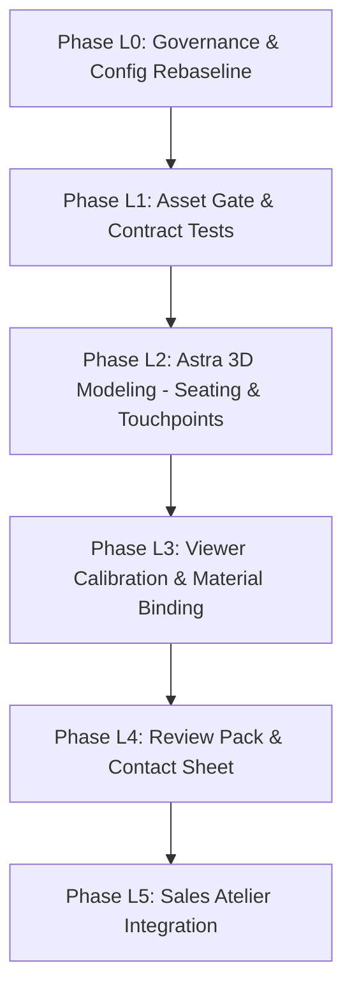

# Lexus RX 350 Demonstration Implementation Plan

**Document:** `docs/LEXUS_IMPLEMENTATION_PLAN.md`  
**Date:** 2026-10-22  
**Status:** PHASED ROADMAP — READY FOR OWNER AUTHORIZATION  
**Target Vehicle:** 2020 Lexus RX 350 AWD  

---

## 1. Phased Delivery Roadmap

The pivot to the 2020 Lexus RX 350 is structured into thin, verifiable, single-responsibility phases. Each phase has explicit automated exit criteria and requires owner approval before proceeding.

---

## 2. Phase Specifications

### Phase L0: Governance & Config Rebaseline
*Scope: Schema validation, vehicle configuration, and scene manifest updates. No 3D modeling.*
1. Create `src/config/vehicles/lexus-rx350-2020.json` conforming to `docs/schemas/vehicle.schema.json`.
2. Create `src/config/scene-manifest.lexus-rx350.json` conforming to `docs/schemas/scene-manifest.schema.json` with zero unresolved slots.
3. Update `src/config/spike-camera-presets.ts` (or create `src/config/lexus-camera-presets.ts`) with the 4 calibrated camera viewports.
4. Update `AtelierHeader.tsx` to display "2020 Lexus RX 350 AWD".
- **Exit Criteria**: `npm run typecheck`, `npm test` exit 0.

---

### Phase L1: Asset Gate & Contract Tests
*Scope: Automated glTF validator update. No Blender modeling.*
1. Update `scripts/validate-glb.mjs` with `--scope lexus` targeting the 5 Lexus nodes (`GEO_Seat_Front_Driver`, `GEO_Seat_Front_Passenger`, `GEO_Seat_Stitching_Front`, `GEO_SteeringWheel_Lexus`, `GEO_Dashboard_Lexus`).
2. Update `tests/contracts.test.ts` to assert that every Lexus node maps to a defined slot with zero allowlisted missing slots.
3. Generate a deterministic synthetic test fixture (`tests/fixtures/lexus-synthetic.glb`) and prove the gate passes.
4. Run mutation tests (rename node, duplicate material, scale distortion, stripped UVs).
- **Exit Criteria**: All unit, contract, and gate tests pass in Vitest.

---

### Phase L2: Astra 3D Asset Modeling (Single Sitting)
*Model: Astra High. Headless Blender 5.2.2 LTS via Python build script.*
*Scope: Front driver seat, front passenger seat, steering wheel, and dashboard upper deck.*
1. Follow `docs/ASTRA_LEXUS_HANDOFF.md` and reference photos `LRX-08`, `LRX-23`, `LRX-29`, `LRX-30`, `LRX-31`.
2. Author headless script `tools/build-lexus-asset.py`:
   - `GEO_Seat_Front_Driver`: Ergonomic cushion with fluted central insert, 3.5 mm seam recess, outer side bolster, and power-switch base trim.
   - `GEO_Seat_Front_Passenger`: Symmetrical mirrored counterpart.
   - `GEO_Seat_Stitching_Front`: Dedicated perimeter seam geometry for contrast thread recolouring (Decision D1).
   - `GEO_SteeringWheel_Lexus`: 3-spoke wheel with airbag boss and grip contours.
   - `GEO_Dashboard_Lexus`: Upper cowl sweep and central display housing framing the seats.
3. Export Draco-compressed GLB to `public/assets/3d/lexus-rx350/lexus-interior.glb`.
4. Run `node scripts/validate-glb.mjs --scope lexus`.
- **Exit Criteria**: Asset gate exits 0 with SHA-256; triangles $\le 45,000$; file size $\le 2.5\text{ MB}$; draw calls $\le 6$.

---

### Phase L3: Viewer Calibration & Material Binding
*Scope: R3F Canvas and material swapper calibration. No geometry edits.*
1. Connect `SpikeViewer.tsx` (or `LexusViewer.tsx`) to load the new Lexus asset.
2. Verify material swapping across `MAT_Seat_Primary`, `MAT_Seat_Secondary`, and `MAT_Seat_Stitching`.
3. Calibrate smooth camera transitions between the 4 viewpoints (`hero_driver`, `seam_macro`, `cabin_pair`, `driver_cockpit`).
4. Validate WebGL context loss recovery and mobile touch interaction in Playwright.
- **Exit Criteria**: Playwright E2E tests pass; deliberate broken binding test fails as expected.

---

### Phase L4: Review Pack & Human Visual Acceptance
*Scope: Assemble visual evidence for owner review. No agent self-scoring.*
1. Generate 4 high-resolution Blender Cycles renders matching the 4 calibrated camera angles.
2. Capture matching desktop and mobile screenshots from the running WebGL viewer.
3. Build a side-by-side contact sheet placing Blender renders, WebGL captures, and authentic Herb Chambers photographs side-by-side.
4. Provide a blank human review sheet in `docs/review/lexus-2026-10-xx/review.md`.
- **Exit Criteria**: Contact sheet generated; blank scoring sheet prepared; owner scores visual fidelity.

---

### Phase L5: Sales Atelier & Lead Integration
*Scope: Reference code generation and WhatsApp handoff.*
1. Verify reference code generation (`AL-SC-2026-XXXXXX`) stores the full configuration state (material, primary hue, secondary hue, thread, composition).
2. Wire up the pre-populated WhatsApp consultation link passing the exact configuration string to the AutoLab atelier.
3. Run comprehensive production build and deployment smoke test.
- **Exit Criteria**: Production build passes; zero console warnings; end-to-end inquiry link tested.

---

## 3. Strict Non-Goals & Prohibitions

1. **NO Complete Cabin Reconstruction**: Do NOT model rear seats, carpets, headliner, door panels, or chassis.
2. **NO Kinematic Rigs**: Seats and steering adjustments remain static.
3. **NO Unrestricted Free Camera Orbit**: Camera must not clip through geometry or orbit into unmodelled rear voids.
4. **NO Third-Party Geometry Purchases**: All geometry authored headlessly through verified Python scripts.
