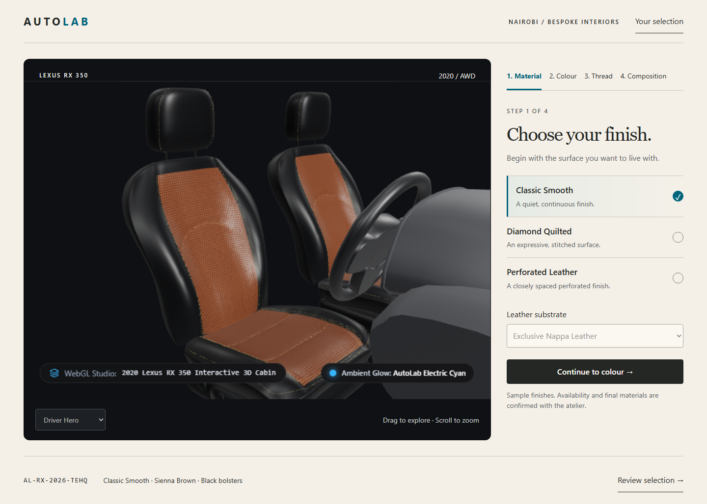
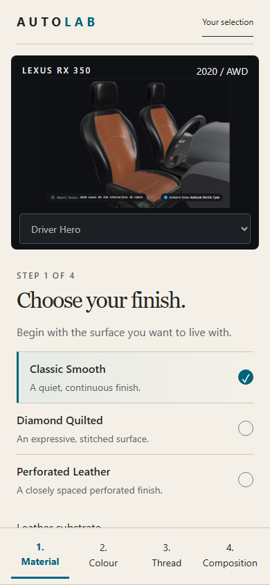

# AutoLab L5 — an editorial automotive atelier

**Owner review checkpoint · 3 November 2026 · proposal only**

The owner selected **warm ivory controls around a graphite stage** during this session. The complete visual direction and implementation are **not approved**. L4 Stage B is technically accepted by the owner. Its model and customer behaviour remain the baseline.

## Open the visual proposal

- [Visual review board](index.html) — current interface, proposed desktop/mobile screens and four-step concepts.
- [Desktop configurator](concepts/html/desktop-configurator.html) / [mobile configurator](concepts/html/mobile-configurator.html) — locally viewable static compositions.
- [Desktop welcome](concepts/html/desktop-welcome.html) / [mobile welcome](concepts/html/mobile-welcome.html).
- [Desktop summary](concepts/html/desktop-summary.html) / [mobile summary](concepts/html/mobile-summary.html).
- [Repository, licence and rendering assessment](REPOSITORIES.md).
- [Implementation slices and rollback boundaries](IMPLEMENTATION-PLAN.md).

The concepts use **actual screenshots of the unchanged Lexus viewer**, with no generated car imagery, copied reference textures or geometry edits. Selection tabs navigate illustrative screens; camera/material selectors are static or disabled. The sample code is a captured example, not a newly generated customer configuration. Do not mistake these HTML compositions for an implemented configurator. Existing technical labels visible *inside the stage image* belong to the source capture; the proposed customer chrome removes those labels while retaining diagnostic access.

## 1. Current-interface critique

New captures were made from the existing production build on local port 3101, at 1440×1000 and 390×844. Chromium 156.0.8078.4 / software rendering; no page exceptions were captured. Both document widths matched their viewports. These checks do not constitute a full accessibility or hardware performance audit.

| Observed issue | Evidence | Proposed correction |
|---|---|---|
| Stage competes with nested cards, cyan outlines, metadata and badges | [Desktop viewport](evidence/current-desktop-viewport.png) | Give the stage approximately 70% of the workbench width; one restrained selection rail; cyan only for selection/focus/brand detail. |
| Customer interface exposes phase/gate/renderer vocabulary | Same capture: Phase L4 Stage B, confirmed dimension, calls/triangles/textures | Keep measurements in a diagnostic disclosure. Use plain customer labels. Keep the meaningful sample/availability caveat visible. |
| Mobile's initial screen exposes almost no selection controls | [Mobile viewport](evidence/current-mobile-viewport.png), [full mobile page](evidence/current-mobile.png) | Compact stage first, readable selection sheet second, four persistent step links at the bottom. Reserve their height so they do not cover content. |
| Bottom summary occupies substantial mobile screen height before choices begin | Mobile capture | Show a compact review entry during selection; detailed summary after composition. Preserve code/copy/spec/WhatsApp actions. |
| Many tiny labels and long booking text compete for attention | Desktop/mobile captures | 16px body text; simpler headings and CTA labels; one primary action per step. |
| Welcome route carries starter branding and synthetic agent-loading copy | [Desktop welcome capture](evidence/current-welcome-desktop.png), [mobile welcome](evidence/current-welcome-mobile.png) | Replace the showroom welcome presentation after approval; no fake progress, agent jargon or new login requirement. Keep direct showroom access. |
| Booking cannot proceed without a configured number | Current capture explicitly says so | Preserve this disabled state and explanation. Do not fabricate a contact number, appointment confirmation or message delivery. |

The current UI's explicit selection state, real camera choices and persistent configuration reference are useful. Preserve those capabilities. The model's dotted/highlight appearance and existing shape issues remain visible in the captures; redesigning the shell does not repair them or approve them.

## 2. Recommended visual direction

**Editorial Luxury**, adapted to AutoLab: warm paper, graphite, clear type and quiet cyan details. The visual signature comes from the contrast between a generous dark model stage and an orderly, light material-selection surface. No unrelated stock photography, gold ornament, fabricated workshop claims or SaaS cards.

### Desktop

An 88px header contains the AutoLab wordmark, Nairobi context and a review link. At 1440px, 48px page gutters frame a 952px stage, 32px gap and 360px selection rail. The four steps sit above that rail. The stage remains mounted throughout selection; only the adjacent choices change. A compact bottom summary presents the reference and review action in normal document flow. Preserve all four camera presets through a compact selector; this is a visual reorganization, not a camera change.

### Mobile

At 390px, a 64px compact header leads into a 280px stage. The selection surface follows in normal flow; it is not a modal covering the cabin. Four bottom step links remain available while scrolling, with reserved bottom space. In implementation, add safe-area padding and test browser chrome/keyboard/landscape. Keep the native page scroll outside the stage; orbit interaction stays confined to the stage. A larger view must reuse the existing viewer rather than creating another canvas.

The mobile composition intentionally accepts vertical scrolling rather than shrinking the type and swatches. A real-phone interaction review is still required; the mock-up cannot prove touch/orbit behaviour.

### Welcome and concierge

The welcome introduces the actual vehicle and the four decisions. “Create your interior” leads directly to the showroom; no compulsory cinematic delay. Summary groups those decisions into a readable specification, then offers the existing WhatsApp handoff. It is a request to discuss the selection, not a purchase, quote or confirmed booking. Existing Spec Sheet and Copy Code actions must remain secondary actions in implementation; the static summary concentrates on hierarchy and does not implement those actions.

## 3. Proposed foundation

Tokens are consistent **within this proposal**, awaiting owner approval for implementation.

| Role | Proposal |
|---|---|
| Display | Georgia, normal/italic, system supplied; 76px desktop welcome, 56px major titles, 38px configurator, 48/32px mobile. No font download or new licence acceptance. |
| Body / controls | Segoe UI → system-ui fallback; 16px body, 1.5 line height, 14px compact labels, 12px nonessential eyebrow. No essential instructions solely in tiny labels. |
| Reference code | Consolas → monospace, 14px. |
| Canvas surround | Graphite `#101115`; does not change scene background, environment, exposure or lighting. |
| Page / surface | Ivory `#F4F0E8` / pale `#FFFCF6`. |
| Main / secondary text | `#242724` / `#60635E`. |
| Brand cyan | Existing `#38B6FF` as a small accent on dark areas. Avoid using this light cyan as small text on ivory. |
| Accessible active ink | Deep teal `#00647B` for selected controls and focus on ivory. This is a chrome token, not a material colour. |
| Rule / border | `#CCC7BC` for decorative separators; stronger borders/focus for actionable elements. |
| Rhythm | 4/8px base; 16px inner gaps, 24/32px groups, 48px desktop margins, 16/24px mobile margins. |
| Radius | 12px major stage; 8px surface; 4px controls; 2px tight details. No nested pill-card stack. |

### Motion specification (not implemented)

- Hover/focus feedback: 120–160ms colour/opacity. Focus is immediate and clearly visible.
- Step panel: 180ms fade + at most 8px translation, stable reserved region; no zoom, material morph or camera auto-movement.
- Selected swatch: immediate selected mark; preserve the existing material-update timing and loading/error semantics.
- Summary reveal: 220ms opacity/translation, focus placed at its heading. Closing returns focus to the invoking control.
- Welcome: static by default; optional one-time ≤4-second ambient movement only if explicitly chosen. No repeating motion behind the live stage.
- Reduced motion: instant panels, no decorative movement. Hidden tabs pause any future animation. No animation of blur, refraction or layout width.

## 4. Exact effect placement

| Reference | Proposed placement | What the proposal actually contains |
|---|---|---|
| Shader Gradient | Optional welcome upper-right background wash only; never across the Lexus materials or selection rail | No shader package, no effect code; still ivory/graphite baseline. Core licence unresolved. |
| Paper liquid-logo | **No runtime placement recommended.** Static AutoLab mark at header left | Original text lockup, no copied shader/logo or liquid animation. |
| R3F | Existing single central Lexus stage, retained throughout the four steps | Actual stage capture only in mock-ups; production runtime untouched. |
| liquid-glass-js | **No JS placement recommended.** Limited glass *appearance* may inform one camera dock at stage bottom | Opaque dock fallback. Later CSS translucency/≤8px blur is optional and requires contrast/device checks. |

No effects on leather previews, selection text, configuration codes or booking controls. The complete dependency/licence/source rationale is in [REPOSITORIES.md](REPOSITORIES.md).

## 5. Preservation contract

Implementation must preserve these behaviours and artifacts, even where the static concept shows only representative choices:

- All current production Lexus GLBs, KTX2 maps, Draco/Basis resources, scene node names, UVs, geometry and manifests.
- Decoder recovery, renderer ownership/cleanup, failed cache eviction and Retry, context/error reporting, required-map checks and 2D fallback.
- All seven exact bindings: `MAT_Seat_Primary`, `MAT_Seat_Secondary`, `MAT_Seat_Stitching`, `MAT_Steering_Leather`, `MAT_Dashboard_Trim`, `MAT_Cockpit_Accent`, `MAT_Cockpit_Black`.
- Classic Smooth, Diamond Quilted and Perforated Leather; Diamond thread integration; repeated switching and the existing L3 rollback path.
- Cabin Pair, Driver Hero, Cockpit & Dash and Stitch Detail with their existing camera values, orbit controls and limits.
- Material → Colour → Thread → Composition, including substrate compatibility, all catalogue options, secondary hide and the existing proposed trim/ambient disclosure. Do not promote proposed entries to confirmed stock.
- Existing configuration state, reference-code algorithm, copy behaviour, Spec Sheet, selection summary and WhatsApp payload/URL semantics. Preserve the unavailable-number state and send nothing automatically.
- Existing scene lighting, demand rendering, DPR, post-render metrics and diagnostic access. Moving diagnostic presentation is not permission to remove instrumentation.
- All human visual gates, reference gaps, model defects, audit findings and catalogue signoffs remain as recorded. No new geometry or visual acceptance is implied.

## 6. State and accessibility design

The local concept supports `?state=loading`, `?state=empty`, `?state=error`; the default depicts a populated selection. `?step=0..3` shows each step. These are review controls, not app integrations.

| State | Customer behaviour to preserve or implement after approval |
|---|---|
| Loading | Keep selection controls and current choices; reserve stage space; show accurate loading status without fabricated percentages. |
| Empty | Prompt for a finish; do not imply a saved or booked configuration. |
| Preview error | Retain choices, offer Retry and existing fallback/specification path. No forced full journey restart. |
| Success | Indicate the selected option with text/check as well as colour; update summary via existing state. |
| Unavailable contact | Disable booking with visible reason; keep code/spec available. |

Implementation acceptance: keyboard sequence follows steps/options/continue/review; radio groups expose selected values; camera presets remain keyboard accessible; labels accompany all swatches; focus returns after closing summary; error/status changes are announced without stealing focus. At least 44×44px controls, 8px separation where applicable, 4.5:1 text and 3:1 UI contrast. Validate 200% zoom, 320px width, reduced motion, forced colours and actual iOS/Android browsers. Static disabled selectors are deliberate mock-up limitations, not accessibility certification.

## 7. Validation and limitations

- `node docs/review/l5-design-direction/capture-current.mjs` — exit 0. Two viewports, current welcome and configurator captures, actual stage captures; no page exceptions. [Actual output](evidence/current-capture.json).
- `node docs/review/l5-design-direction/build-concepts.mjs` — exit 0. Six isolated HTML screens, shared token/style/JS files and manifest.
- `node docs/review/l5-design-direction/verify-concepts.mjs` — exit 0. Six base pages; 52 local HTML references resolved; no missing images; one H1 per base page; no horizontal overflow at 1440/390px or the 320px configurator check; first keyboard focus is a link. All four steps and three alternative preview states captured for both platforms. [Actual output](evidence/concept-checks.json).
- Visual inspection: desktop welcome/configurator, mobile configurator and summary compositions checked. Mobile summary spacing and step navigation were corrected once. This is layout review, not human acceptance of the 3D asset.
- No production tests/build were rerun: only documentation and isolated static compositions changed. L4 results are historical baseline evidence, not new L5 test results. No dependency audit rerun or findings closed.
- External effect demos were not executed; no effect performance claims, real-phone measurements, screen-reader certification or Safari/Firefox validation. No new shaders, fonts or texture assets were acquired.
- Initial package-version inspection using `require('three/package.json')` hit Three's package-export restriction. Reading installed package manifests from disk resolved it; [actual versions](evidence/installed-versions.json). Initial Git/API calls were blocked by the sandbox and succeeded with scoped approval. A STATE patch syntax error was corrected before writing; no partial file deletion occurred.
- Git scope/preservation and colour contrast results are recorded in [consistency checks](evidence/consistency.json). Runtime source, assets and dependencies must remain identical to `ff9dabf`.

## Owner approval required

Please review the desktop and mobile compositions, then approve or request changes to:

1. The editorial typography, ivory/graphite balance and restrained cyan treatment.
2. Desktop stage/rail proportions and mobile stage/selection/bottom-step layout.
3. The welcome and concise concierge summary, with code/copy/Spec Sheet/WhatsApp preserved.
4. The **zero new rendering dependencies** recommendation: existing R3F only; no liquid logo or refractive JS glass; optional subtle welcome wash and limited CSS dock treatment remain deferred.

**STOP: no implementation, dependency installation, production UI change, push or deployment is authorized by this proposal.** Palette choice is recorded; all four items above await owner review. Technical acceptance of L4 does not sign any human visual gate.
