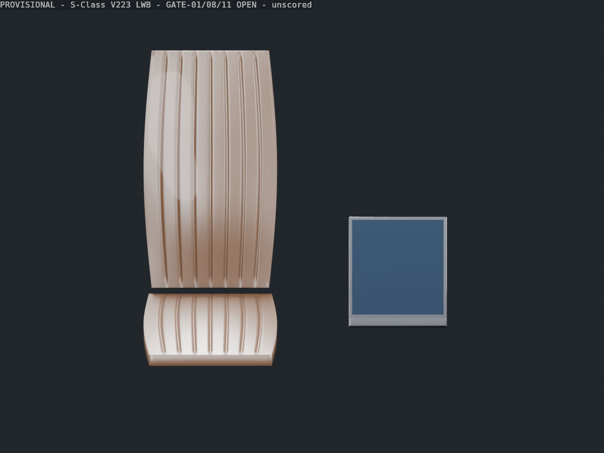

# Phase 3–5 review pack

**PROVISIONAL: Mercedes-Benz S-Class V223 LWB. GATE-01, GATE-08, GATE-11 OPEN. No human score or production acceptance.**

Session began 2026-10-20; final renders captured 2026-10-21 after the owner's continuation. Folder date identifies the session. Source/tooling commit: `964db795ee09299cc16d9ba32cce0f153019220c`.

These are Blender 5.2.2 Cycles **CPU** renders of the delivered GLB, imported with Draco decoding. Same area lights/world, AgX, 24 samples, 1200x900, four threads for every view. Camera presets and SHA-256 ties are in [render-report.json](render-report.json). Final per-view times: 60.931s, 57.351s, 54.940s, 49.190s, 30.509s; all below the five-minute cap. Round 2 changed framing/isolation and stamps only; GLB unchanged.

## Views and visible limitations

| File | Coverage | Known limitations; no rating |
| :--- | :--- | :--- |
| [01-overview.png](01-overview.png) | Both components | Isolated review layout; base/back separation and simplified insert outline |
| [02-seat-front.png](02-seat-front.png) | Seat inserts only | Hard groove ends; polygonal shading; placeholder leather |
| [03-seat-detail.png](03-seat-detail.png) | Backrest contact surface | Sharp baked grooves, smooth synthetic grain, shading patches; cropped close-up |
| [04-oled-front.png](04-oled-front.png) | Active face and lower strip | Blank non-emissive face; no interface, button legends, roller or recess details |
| [05-oled-profile.png](05-oled-profile.png) | Oblique housing/bezel | Harsh edge reflections; provisional thickness/angle; rear mount and console omitted |

## Evidence

- [Full Phase 3 report](../../spike/phase-3-report.md): commands, sources, uncertainty, deviations and full gate output/JSON.
- [Gate report](evidence/gate-final.json): real scoped asset, exit 0 with explicit WebP waiver. SHA-256 `36a107f152039a464d4a4dd7786794f66ea40628b5c97ad2d8083964ad1b458e`.
- [Repeatability](evidence/repeatability.json): two clean builds, identical counts and raw/final GLB hashes.
- [Initial raw export failure](evidence/raw-gate-failure.json): retained rather than hidden.
- [Application tests](evidence/tests.txt): 31 passed. [Production build](evidence/build-app.txt): exit 0.
- [Provenance](../../3d-assets/provenance.json) and [cost log](../../spike/cost-log.md).

## Phase 5 owner review checkpoint

- [Contact sheet](contact-sheet.png): five Blender renders beside the matching desktop and mobile viewer captures; the owner-reference column is marked **NOT SUPPLIED** because no physical vehicle or hide photos are stored here. [Generator](make_contact_sheet.py) arranges the original evidence without retouching it.
- [Blank human scoring form and owner checklist](review.md): visual fidelity, desktop interaction and named mid-range phone performance. No score or signature has been entered.
- [Decision facts and pending GO/HYBRID/NO-GO form](../../spike/decision.md): technical gate PASS is separate from visual acceptance.
- [Phase 4 viewer evidence](viewer/README.md): 8/8 full browser tests, 10 captures and headless renderer statistics. Real-phone FPS/GPU memory remain **NOT MEASURED**.

The historical Phase 3 checkpoint above preceded the viewer; Phase 4 evidence is now linked here. GAP-01 through GAP-04 and GATE-01, GATE-08 and GATE-11 remain open. No human visual acceptance or production ruling is inferred.
